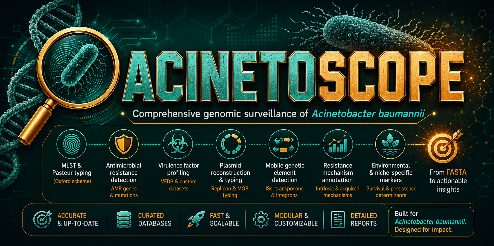

<p align="center">
  
</p>

<div align="center">

# 🧬 AcinetoScope

### **A species‑specific computational pipeline for rapid, comprehensive *Acinetobacter baumannii* outbreak investigation and resistance gene tracking**

#### **Complete genomic surveillance in a single automated workflow — from FASTA to actionable insights.**

[](CODE_OF_CONDUCT.md)
[](https://anaconda.org/bbeckley-hub/acinetoscope)
[](https://anaconda.org/bbeckley-hub/acinetoscope)
[](https://anaconda.org/bbeckley-hub/acinetoscope)
[](LICENSE)
[](https://anaconda.org/bbeckley-hub/acinetoscope)
[](https://anaconda.org/bioconda/acinetoscope)
[](https://doi.org/10.1038/s41598-026-70189-y)

[](https://hub.docker.com/r/bbeckleyhub/acinetoscope)
[](https://hub.docker.com/r/bbeckleyhub/acinetoscope)
[](https://hub.docker.com/r/bbeckleyhub/acinetoscope)
[](#)
[](https://www.linkedin.com/in/brown-beckley-190315319)
[](#)

[](https://github.com/bbeckley-hub/acinetoscope)
[](https://github.com/bbeckley-hub/acinetoscope)
[](https://github.com/bbeckley-hub/acinetoscope)
[](https://github.com/ellerbrock/open-source-badges/)
[](https://github.com/bbeckley-hub/acinetoscope)

[](https://bbeckley-hub.github.io/acinetoscope)
[](https://www.sphinx-doc.org/)
[](https://github.com/bbeckley-hub/acinetoscope/commits)
[](https://github.com/bbeckley-hub/acinetoscope/graphs/contributors)
[](https://github.com/PyCQA/bandit)

[](https://github.com/psf/black)
[](https://pycqa.github.io/isort/)
[](https://github.com/astral-sh/ruff)
[](https://github.com/pre-commit/pre-commit)
[](https://github.com/bbeckley-hub/acinetoscope/actions)
[](https://github.com/bbeckley-hub/acinetoscope/tests)
[](https://gitpod.io/#https://github.com/bbeckley-hub/acinetoscope)

[](https://github.com/bbeckley-hub/acinetoscope#performance-benchmarks)
[](https://github.com/bbeckley-hub/acinetoscope)
[](https://github.com/bbeckley-hub/acinetoscope)
[](https://github.com/bbeckley-hub/acinetoscope)
[](https://bbeckley-hub.github.io/abyss/)

[](https://www.python.org/downloads/)
[](https://docs.conda.io/en/latest/)
[](LICENSE)
[](https://github.com/bbeckley-hub/acinetoscope/issues)
[](https://github.com/bbeckley-hub/acinetoscope/stargazers)
[](https://htmlpreview.github.io/?https://bbeckley-hub.github.io/acinetoscope/#summary)


**Two ways to use AcinetoScope:**  
🖥️ **Command-line tool** for high-throughput, reproducible, local analysis  
🌐 **ABYSS Browser** for selecting the right public *A. baumannii* genomes — [https://bbeckley-hub.github.io/abyss/](https://bbeckley-hub.github.io/abyss/)

</div>

---

## 🎉 **What’s New in v1.4.0 — ABYSS Integration, MGE Profiling, and HPC-Ready Database Management**

We built v1.4.0 around three questions that kept coming back from users: *“how did these resistance genes get here?”*, *“how do I keep a 500-genome run from filling the disk?”*, and *“how do I find the right public genomes to compare against?”*. This release answers all three, and it makes the pipeline friendlier on shared HPC filesystems at the same time.

### 🌐 **1. ABYSS — the Browser for Public *A. baumannii* Genomes**

**ABYSS** (**A**cinetobacter **b**aumannii **Y**ielding **S**urveillance **S**ystem) is the open-access companion resource to AcinetoScope. It solves the retrieval problem that dominates genomic epidemiology: **getting the exact subset of public genomes you need, without writing a single line of code.**

**The problem:** You want all Pasteur ST2, IC2, KL2, OCL1 bloodstream isolates from Germany between 2015 and 2022 carrying *bla*<sub>OXA-23</sub>. In existing repositories, that means downloading multiple compressed tables, writing custom scripts to cross-reference typing, gene presence, and metadata, and manually merging files. It is slow, error-prone, and requires coding skills that many clinical and public-health researchers do not have.

**The solution:** ABYSS puts the public *A. baumannii* collection in your browser. Filter by Pasteur MLST, international clone, OXA-51 variant, Kaptive KL and OCL capsule type, AMR genes (carbapenemase-aware), virulence factors, plasmid replicons, country, isolation source, host, and collection year — all in real time.

**Click. Filter. Export.** The result is a plain-text accession list, ready for:

```bash
datasets download genome accession --inputfile list.txt
```

**ABYSS by the numbers (v0.1):**

| Metric | Value |
|---|---|
| **Genomes** | **59,160** public *A. baumannii* accessions, growing with each release |
| **Typing modules** | Pasteur MLST · International Clones IC1–IC12 · OXA-51 variants · Kaptive KL + OCL |
| **Gene modules** | AMR (carbapenemase-aware) · Virulence (VFDB) · Plasmid replicons |
| **Metadata coverage** | Country 96% · Source 83% · Host 91% · Year 95% |
| **Interactive pages** | 12 pages, all static, all over HTTPS |
| **Access** | No login. No API key. No installation. |

> **ABYSS is part of the ARGUS family** — the same open-surveillance architecture as SAURUS for *S. aureus* and ECLIPSE for *E. coli*. Each resource is accession-first, metadata-integrated, and MIT-licensed.

**[🚀 Explore ABYSS Now →](https://bbeckley-hub.github.io/abyss/)**

### 🧬 **2. MGE Profiling — Because Resistance Needs a Postal Address**

Every genome now gets full mobile genetic element profiling through the manually curated **mobileOG-db**. Per-hit detail is parsed, aggregated per sample, and rendered in a dedicated MGE tab inside both interactive reports.

**Why this changes interpretation:**
- **Resistance dissemination:** A plasmid-associated gene cluster appearing in two unrelated STs is a smoking gun for horizontal transfer.
- **Virulence acquisition:** Capsule and biofilm modules are frequently mobilised by integrative elements.
- **Persistent infections:** Strong stability systems let plasmids survive without antibiotic selection.
- **Outlier detection:** An isolate with double the cohort’s MGE load is either something new or something wrong. Either way, worth a closer look.

MGE results live in `mge_results/` and are embedded in the gene-centric and sample-centric reports. The module can be skipped with `--skip-mge`.

### 📉 **3. Report-Level Disk Management**

New `--report-level {final,summary,full}` flag. On a large cohort, `final` keeps only the consolidated report directory. `summary` (default) retains batch summaries in each module directory. `full` keeps everything. A safety check prevents pruning if the final report directory is missing or empty — the run never self-destructs.

### 🗄️ **4. MLST Database Management**

Two new commands mirror the StaphScope workflow:
- **`--pull-mlst-db`** — downloads a pre-built *A. baumannii* scheme from GitHub (no API key, roughly two minutes). Prunes to the **Oxford + Pasteur** schemes only.
- **`--update-mlst-db`** — fetches the latest alleles directly from PubMLST (API key required, 10–20 minutes).

Both commands honour `ACINETOSCOPE_MLST_DB` and `ACINETOSCOPE_MLST_MODULE_PATH`, which matters in Docker, Apptainer, and shared conda environments where the packaged module directory may be read-only.

### 🖥️ **5. HPC-Friendly by Default**

All modules write temporary files to `/tmp`, so **Singularity and Apptainer users no longer need `--writable-tmpfs`** unless the cluster restricts `/tmp`. Output files are owned by your real UID. Every database path can be redirected with an environment variable, so shared Lustre, NFS, and BeeGFS filesystems work without copying databases into every home directory.

### 🗂️ **6. Clean, Predictable Output Directory**

Each module writes its own directory; the final report consolidates the deliverables. `--clean-output` deletes the output directory before analysis when you need a fresh start. `--keep-temp` preserves temporary directories for debugging.

### 📝 **7. Complete Subprocess Logging**

`acinetoscope_run.log` now captures full stdout and stderr from every module — no truncation. When a module fails, its complete output is echoed to the console with the exact traceback.

### 🐳 **8. Docker Image Refresh**

The image is rebuilt with every database baked in during build: MLST, AMRFinderPlus, ABRicate, Kaptive, APT, and mobileOG-db. First-run network calls are zero. Pull and run.

---

## 🎯 **Overview**

**AcinetoScope** is an automated, comprehensive bioinformatics pipeline designed specifically for the genomic analysis of *Acinetobacter baumannii*, a WHO **Critical Priority** pathogen responsible for devastating hospital-acquired infections, especially in intensive care units. Carbapenem-resistant *A. baumannii* (CRAB) is among the most difficult-to-treat multidrug-resistant organisms.

### The Problem
- **Fragmented Workflows:** Analyzing *A. baumannii* requires manual chaining of six or more separate tools with conflicting dependencies.
- **Interpretation Barrier:** Raw outputs from multiple tools need manual integration to form an epidemiological narrative.
- **Resource Barriers:** Generalist pipelines are slow and are not optimised for *A. baumannii*.
- **Cloud/HPC Limitations:** Many pipelines fail on read-only filesystems or leave behind clutter.

### Our Solution
AcinetoScope delivers:
- ✅ **End-to-End Automation:** One command runs the entire analysis from raw FASTA to a consolidated report.
- ✅ ***A. baumannii*-Optimized:** Pre-configured with species-specific databases and typing schemes (Pasteur and Oxford MLST, Kaptive K/O loci, APT plasmid typing).
- ✅ **Actionable Intelligence:** Sample-centric and gene-centric tracking with dynamic grouping.
- ✅ **Speed & Efficiency:** Benchmarked **40–75% faster** than generalist pipelines.
- ✅ **AI-Ready Outputs:** Interactive HTML reports designed for exploration with modern AI browser extensions.
- ✅ **HPC/Cloud-Ready:** All modules run in temporary directories and every database path is overridable.

**Perfect for:** Hospital outbreak investigation, public health surveillance, antimicrobial resistance research, and clinical microbiology.

---

## ✨ **Key Features**

### 🔬 **Core Analytical Modules**

| Module | 🎯 Purpose | 📊 Key Outputs | ⚡ Speed |
| :--- | :--- | :--- | :--- |
| **Quality Control** | Assembly metric assessment and integrity checking | N50/N75, GC%, ambiguous bases, homopolymers | <1 min |
| **Species Confirmation** | Species assignment via fastANI | Species name, ANI %, contamination flag | <1 min |
| **Dual MLST Typing** | Phylogenetic classification via Pasteur and Oxford schemes | Sequence Type, International Clone, novel alleles | <1 min |
| **Capsule (K/O) Typing** | Polysaccharide capsule and lipooligosaccharide typing via Kaptive 3 | K type, O type, locus coverage and identity | 1–2 min |
| **AMR Detection** | Comprehensive resistance gene detection with AMRFinderPlus | Carbapenemases, ESBLs, colistin and tigecycline resistance, four-tier risk flags | 2–3 min |
| **Multi-DB Screening** | Screening across 11 curated databases via ABRicate | Virulence factors, plasmid replicons, metal and biocide resistance, stress regulators | 3–4 min |
| **Plasmid Typing (APT)** | *Acinetobacter*-specific plasmid typing | Rep type families, per-genome rep types | 1–2 min |
| **MGE Profiling** | mobileOG-db mobile element signatures | Per-sample category counts, key MGE signatures | 2–3 min |
| **Gene-centric Reporter** | Integrates all results into a gene-centric interactive HTML report | Dynamic grouping by typing, mutation tab, co-occurrence, combinations, high-risk CRAB | Instant |
| **Sample-centric Reporter** | Per-isolate interactive boxes with typing badges and all gene tables | Patient-centred view, filtering, export, print | Instant |

### 📊 **Sample Integrated Reports**

Curious what the output looks like? Open the live reports below. Both are fully interactive and contain real *A. baumannii* typing, K/O locus, AMR, virulence, mutation, and MGE content.

<div align="center">

| | |
|:---:|:---:|
| <a href="https://bbeckley-hub.github.io/acinetoscope/genius_acinetobacter_sample_centric_report.html"></a><br><sub>Each isolate as an interactive box with full gene profile</sub> | <a href="https://bbeckley-hub.github.io/acinetoscope/genius_acinetobacter_ultimate_gene_centric_report.html"></a><br><sub>Each gene with all genomes that carry it – groupable by typing</sub> |

</div>

> **Note:** The reports may take a few seconds to load. For the best experience, download the HTML files and open them locally. Every report is self-contained and offline-capable.

---

## 🔥 **Feature Deep-Dives**

<details>
<summary><b>⚖️ The Dual MLST Engine — Because Pasteur and Oxford Disagree (and That’s the Point) (Click to expand)</b></summary>
<br>

* A. baumannii has two widely used MLST schemes. The Pasteur scheme is the one most commonly used for international clone assignment. The Oxford scheme resolves finer within some lineages. They do not always produce the same sequence type, and that is not a bug — it is a feature of two different sets of housekeeping genes.

**AcinetoScope runs both by default.** `--mlst-scheme both` is the default. You can restrict to `pasteur` or `oxford` when you need to match a legacy analysis exactly, but the default gives you the cross-scheme view that outbreak papers increasingly expect.

**Why two schemes matter:**
- **International Clone assignment.** The Pasteur scheme is the standard backbone for IC1–IC12. If you report only Oxford STs, reviewers will ask for the Pasteur equivalent.
- **Discordance analysis.** When Pasteur and Oxford tell different stories, that is a signal about recombination or about a lineage that sits between named clones. Both columns are preserved in the final report.
- **Publication-ready.** Reviewers ask which scheme you used. A two-scheme answer is a stronger answer.

**The honest caveat:** MLST is not a transmission marker. Two isolates with the same ST can be separated by hundreds of SNPs. The dual scheme tells you lineage context; it does not prove recent transmission. Use the gene-centric and sample-centric views for gene content, and treat MLST as the skeleton, not the diagnosis.

</details>

<details>
<summary><b>🛡️ The Species Gate — Because Klebsiella Should Not Be Typed as A. baumannii (Click to expand)</b></summary>
<br>

A mislabelled *Klebsiella pneumoniae* assembly run through a Kaptive capsule typer will produce a confident, wrong answer. An *Acinetobacter nosocomialis* genome run through the Pasteur MLST scheme will either fail or return a spuriously close ST.

AcinetoScope prevents both. FASTA QC performs a fastANI species check and writes `FASTA_QC_species_passed.txt`. Only samples that pass the *A. baumannii* species confirmation (ANI ≥ 95%) flow into downstream modules. Non-target assemblies are excluded with a logged warning and listed individually in the log.

**Why this matters at scale:** On a 500-genome surveillance run, it is not unusual to find 2–5% mislabelled or contaminated entries. Without a species gate, every downstream analysis silently inherits those errors. With it, you get a clean downstream dataset and an explicit audit trail of what was excluded and why.

**A detail worth knowing:** If FASTA QC is skipped or fails, the gate file is absent and **all samples proceed** through downstream modules. That is deliberate — a missing QC step should not silently delete your data — but it means you should always check `FASTA_QC_species_passed.txt` before trusting a large run.

</details>

<details>
<summary><b>📱 The MGE Tab — Where Resistance Gets a Postal Address (Click to expand)</b></summary>
<br>

You have AMR genes. You have virulence genes. You know *what* a genome carries. But *how did it get there?*

**Mobile genetic elements are the answer.** Plasmids, transposons, integrative conjugative elements, and insertion sequences are the physical vehicles that shuttle resistance and virulence genes between unrelated bacteria. If you do not understand the MGE landscape, you are looking at the mail without ever seeing the postal system.

**What the MGE tab gives you:**
- **Per-sample counts** across functional categories: integrase, transfer, stability, phage, replication, IS-associated, ICE-associated, plasmid-associated, phage-associated, and key MGE signatures.
- **Aggregate profiles by typing** — mean MGE load per Pasteur ST, per Oxford ST, per K locus, per O locus, per capsule type. High MGE burden in one lineage but not another is a real signal.
- **Top-N views** — the isolates with the most IS-associated proteins, plasmid proteins, or high-confidence MGE signatures.
- **Education cards** — because “what is an IS element and why do I care?” is a question that deserves a proper answer inside the report, not a trip to Wikipedia.

**What it helps with:**
- **Resistance dissemination:** A plasmid-associated gene cluster in two unrelated STs is a smoking gun for horizontal transfer.
- **Virulence acquisition:** Capsule and biofilm modules are often mobilised.
- **Persistent infections:** Strong stability systems let plasmids survive without selection.
- **Outlier detection:** An isolate with twice the cohort’s MGE load is either something new or something broken. Either way you should look.

**A word of honesty:** mobileOG-db counts protein *signatures*, not reconstructed elements. Multiple proteins from the same element produce multiple hits, and some categories also fire on chromosomal genes. That is why we use the word “signatures” everywhere. If you want element-level claims, you need co-localisation analysis — which is a bioinformatics project, not a column in a dashboard.

</details>

<details>
<summary><b>📉 Report Levels — Because Disk Is Not Infinite (Click to expand)</b></summary>
<br>

AcinetoScope produces substantial intermediate output by default. On a 500-genome cohort that adds up fast. The `--report-level` flag gives explicit control.

| Level | What is kept | What is removed | Best for |
|---|---|---|---|
| `final` | Only `AcinetoScope_final_report/` — the consolidated gene-centric and sample-centric reports plus the run log | Every module directory | Archival, very large cohorts, HPC quota, shared filesystems |
| `summary` (default) | Final report **plus** batch TSVs, HTMLs, and JSONs in each module directory | Per-sample subdirectories | Normal day-to-day work |
| `full` | Everything, including per-sample HTMLs and raw files | Nothing | Debugging, small cohorts, per-sample downstream analysis |

Under the hood, `final` deletes every module directory after consolidation, `summary` deletes only per-sample subdirectories, and `full` keeps everything. A safety check prevents pruning if `AcinetoScope_final_report/` is missing or empty, so the run never self-destructs.

**Rule of thumb:** use `final` for archival and very large cohorts, `summary` for normal work, and `full` only when you are debugging or when you have a specific per-sample downstream analysis planned.

</details>

<details>
<summary><b>🌐 ABYSS — Because Retrieval Is the Bottleneck (Click to expand)</b></summary>
<br>

The hardest part of comparative genomics is often not the analysis. It is getting the right genomes.

**The retrieval problem:** You want all Pasteur ST2, IC2, KL2 bloodstream isolates from Germany between 2015 and 2022 carrying *bla*<sub>OXA-23</sub>. In a traditional repository, this means downloading multiple compressed tables, writing a script to cross-reference typing, gene presence, and metadata, and merging files by hand. It is slow, error-prone, and requires coding skills that many clinical and public-health researchers do not have.

**The ABYSS solution:** ABYSS is a static, browser-based resource that integrates typing, gene annotation, and epidemiological metadata into a single queryable interface. You filter by genotype **and** geography **and** source **and** year. You export a plain-text accession list. You feed that list to NCBI:

```bash
datasets download genome accession --inputfile list.txt
```

That is the entire workflow. No installation, no account, no API key. ABYSS runs entirely over HTTPS on GitHub Pages, which makes it immune to server outages, API rate limits, and funding deprecation.

**Why this belongs in an AcinetoScope README:** AcinetoScope analyses your genomes. ABYSS helps you choose the public genomes to compare them against. The two tools are designed to be used together, and they are both part of the ARGUS family of species-specific surveillance resources.

**The honest caveat:** ABYSS is a retrieval and annotation resource, not a phylogenetic tool. An accession list from ABYSS is a starting point for comparative analysis, not a conclusion. You still need to run the genomes through AcinetoScope (or another pipeline) and interpret the output in the context of your study design.

</details>

<details>
<summary><b>🧬 Gene-Centric vs Sample-Centric — Because One View Is Never Enough (Click to expand)</b></summary>
<br>

AcinetoScope produces two integrated reports, and they answer different questions.

**Gene-centric report:** every resistance gene, virulence gene, plasmid replicon, mutation, and MGE signature is shown with all genomes that carry it. You can dynamically regroup the genome list by Pasteur ST, Oxford ST, K locus, O locus, capsule type, or combinations such as `ST-K:O`. This is the view for dissemination patterns and clonal association.

**Sample-centric report:** every isolate is an interactive box with typing badges and all of its gene and mutation tables. This is the view for clinical review, single-isolate investigation, and explaining a case to a clinician.

**Why both exist:** A gene-centric view answers “who carries this gene?” A sample-centric view answers “what does this isolate carry?” Those are different questions, and forcing one view to answer both produces a table that is good at neither.

**Interactive features shared by both reports:**
- **Dynamic grouping** — reorganise genome lists by typing scheme or combination.
- **Search and filter** — find specific samples or genes instantly.
- **Export to CSV** — download any table for further analysis.
- **Print-friendly** — print any section with the built-in button.
- **Horizontally scrollable tables** — no data truncation.

**The honest caveat:** neither report computes core-genome SNPs. Identical typing and identical gene content are hypothesis generators, not proof of transmission. We use the phrase “possible transmission pair” deliberately. If you need SNP-level resolution, that is a separate analysis, and AcinetoScope does not pretend to replace it.

</details>

---

## ⚡ **Quick Start (CLI)**

### Install in 60 seconds
```bash
# Conda (recommended)
conda create -n acinetoscope -c conda-forge -c bioconda acinetoscope -y
conda activate acinetoscope
```

### Run your first analysis
```bash
# Single genome
acinetoscope -i genome.fasta -o results/

# Batch processing (24 genomes)
acinetoscope -i "*.fna" -o batch_results --threads 16
# Complete in ~10–15 minutes
```

### Update databases (recommended for conda users)
```bash
# ABRicate databases
abricate --setupdb

# AMR database (incremental)
acinetoscope --update-amr-db

# MLST database (Oxford + Pasteur, no API key)
acinetoscope --pull-mlst-db
```

> **Docker and Singularity users:** every database is baked into the image. You do not need `abricate --setupdb`, `--update-amr-db`, or `--pull-mlst-db`. Pull and run.

---

## 🔧 **Installation (CLI)**

<details>
<summary><b>System requirements and step-by-step installation (Click to expand)</b></summary>
<br>

### System Requirements

| Resource | Minimum | Recommended | Production |
|---|---|---|---|
| **CPU Cores** | 2 | 8+ | 16+ |
| **RAM** | 4 GB | 8 GB | 16 GB |
| **Storage** | 2 GB | 10 GB | 50 GB+ |
| **OS** | Linux, macOS, WSL2 | Linux | Linux Cluster |

### Step 1 — Install Miniconda (if needed)

```bash
wget https://repo.anaconda.com/miniconda/Miniconda3-latest-Linux-x86_64.sh
bash Miniconda3-latest-Linux-x86_64.sh
source ~/.bashrc
```

### Step 2 — Install AcinetoScope

Channel order matters. Add `conda-forge` first, then `bioconda`.

```bash
conda config --add channels conda-forge
conda config --add channels bioconda

conda create -n acinetoscope -c conda-forge -c bioconda acinetoscope -y
conda activate acinetoscope

acinetoscope --help
```

### Step 3 — Update databases (recommended)

```bash
abricate --setupdb
acinetoscope --update-amr-db
acinetoscope --pull-mlst-db
```

### Step 4 — Verify the installation

```bash
acinetoscope --help
acinetoscope --version
```

If `--help` prints the full usage banner, the installation is complete.

</details>

---

## 🐳 **Docker & Singularity Usage — Avoid the Padlock 🔓**

Docker and Singularity users get **everything pre-installed**: MLST, AMRFinderPlus, ABRicate databases, Kaptive, APT, and mobileOG-db are baked into the image. There is no first-run database setup.

<details>
<summary><b>🐳 Docker (laptops, workstations, cloud VMs) (Click to expand)</b></summary>
<br>

Docker runs containers as `root` by default, so files written to bind-mounted directories come out owned by `root:root`. Add `-u $(id -u):$(id -g)` to run the container with your host UID and GID.

```bash
# Pull the image
docker pull bbeckleyhub/acinetoscope:1.4.0

# Verify it runs
docker run --rm bbeckleyhub/acinetoscope:1.4.0 --help

# Recommended: no padlock, no sudo chown
docker run --rm \
  -u $(id -u):$(id -g) \
  -v "$(pwd):/data" \
  bbeckleyhub/acinetoscope:1.4.0 \
  -i "/data/*.fna" -o /data/output -t 4
```

- `-u $(id -u):$(id -g)` makes output files owned by **you**.
- `-v "$(pwd):/data"` mounts your current directory as `/data` inside the container.
- `-i "/data/*.fna"` uses the **container path**, not your host path.
- `-o /data/output` writes to `./output/` on your host.

**Image size:** approximately 1.9 GB compressed and 8.3 GB on disk.

**Debugging shell:**

```bash
docker run --rm -it bbeckleyhub/acinetoscope:1.4.0 bash
```

**macOS and Windows (Docker Desktop):** UID/GID mapping works out of the box. The same command is fine.

</details>

<details>
<summary><b>🔬 Singularity / Apptainer (HPC clusters) (Click to expand)</b></summary>
<br>

HPC login and compute nodes do not run the Docker daemon. Singularity or Apptainer is the standard. It runs as your real UID by default, so output files are always owned by you.

```bash
# Load the runtime (module names vary by cluster)
module load apptainer
# or: module load containers/singularity/3.6.4

# Pull the image once (needs internet on the login node)
singularity pull acinetoscope_1.4.0.sif docker://bbeckleyhub/acinetoscope:1.4.0

# Run the pipeline
singularity run --bind "$(pwd):/data" \
  acinetoscope_1.4.0.sif \
  -i "/data/*.fna" -o /data/output -t 16
```

- `--bind "$(pwd):/data"` is the HPC equivalent of Docker’s `-v`.
- **No `-u` flag is needed.** Singularity runs as your real UID.
- **No `--writable-tmpfs` is needed by default** because all modules write temporary files to `/tmp`, which containers mount as writable. If your cluster restricts `/tmp`, add `--writable-tmpfs` as a fallback.

> ⚠️ **Use `singularity run`, not `singularity exec`.** The image entrypoint sets up `PATH` and `LD_LIBRARY_PATH` for the conda environment. `run` invokes it; `exec` skips it and will break AMRFinderPlus.

**SLURM job script:**

```bash
#!/bin/bash
#SBATCH --job-name=acinetoscope
#SBATCH --cpus-per-task=16
#SBATCH --mem=32G
#SBATCH --time=04:00:00
#SBATCH --output=acinetoscope_%j.log

module load containers/singularity/3.6.4
cd $SLURM_SUBMIT_DIR

singularity run --bind "$(pwd):/data" \
  /path/to/acinetoscope_1.4.0.sif \
  -i "/data/*.fna" \
  -o /data/output \
  --report-level final \
  -t ${SLURM_CPUS_PER_TASK}
```

**PBS / Torque job script:**

```bash
#!/bin/bash
#PBS -N acinetoscope
#PBS -l nodes=1:ppn=16
#PBS -l walltime=04:00:00
#PBS -j oe

module load containers/singularity/3.6.4
cd $PBS_O_WORKDIR

singularity run --bind "$(pwd):/data" \
  /path/to/acinetoscope_1.4.0.sif \
  -i "/data/*.fna" \
  -o /data/output \
  --report-level final \
  -t 16
```

</details>

<details>
<summary><b>🤔 Which should you use? (Click to expand)</b></summary>
<br>

| Platform | Recommendation | Command pattern | Output ownership |
|---|---|---|---|
| **Laptop / workstation** | Docker | `docker run --rm -u $(id -u):$(id -g) -v "$PWD:/data" …` | You |
| **HPC login and compute nodes** | **Singularity or Apptainer** | `singularity run --bind "$PWD:/data" acinetoscope.sif …` | You, automatically |
| **Cloud VM** | Either — Docker is simpler | See Docker section | You |
| **Shared cluster without Docker** | Singularity | See Singularity section | You, automatically |

**The rule:** Docker on machines where you control the daemon; Singularity on shared HPC systems where you do not.

</details>

---

## 🖥️ **HPC & Environment Variables**

AcinetoScope is designed to run on shared clusters without copying databases into every user’s home directory. Every important path is overridable. All overrides are optional.

<details>
<summary><b>Full environment-variable reference (Click to expand)</b></summary>
<br>

| Variable | Purpose | Default |
|---|---|---|
| `ACINETOSCOPE_SHARED_DATA` | Writable root for user-local data | `~/.local/share/acinetoscope/` |
| `ACINETOSCOPE_MLST_DB` | MLST database directory | Resolved from the packaged module or the user-local module |
| `ACINETOSCOPE_MLST_MODULE_PATH` | MLST module root containing `bin/`, `db/`, `perl5/`, and `scripts/` | Resolved from `sys.prefix` or the repository |
| `ACINETOSCOPE_MLST_PULL_URL` | Override the default GitHub pull URL for `--pull-mlst-db` | The upstream GitHub archive |
| `ACINETOSCOPE_AMRFINDER_BIN_DIR` | Directory containing `amrfinder` and `amrfinder_update` | Resolved from `PATH` or the packaged module |
| `ACINETOSCOPE_AMRFINDER_DB` | AMRFinderPlus database versioned directory | Resolved from the packaged module or the user-local cache |

### Example: shared databases on Lustre

```bash
export ACINETOSCOPE_MLST_DB=/lustre/scratch/dbs/mlst/pubmlst
export ACINETOSCOPE_AMRFINDER_DB=/lustre/scratch/dbs/amrfinder/2026-08-07.1

acinetoscope -i "*.fna" -o results --report-level final -t 16
```

### Why these variables exist

Docker images, system-wide conda installations, and shared HPC installs often have read-only module directories. If AcinetoScope needs to update a database, it cannot write next to the packaged module. The environment variables let you redirect the writable parts to a location you control, while the code and the read-only databases stay where they are.

### Temporary files on HPC

All modules write temporary files to `/tmp`, not to the installation directory. This is why Singularity and Apptainer users generally do not need `--writable-tmpfs`. If your cluster restricts `/tmp`, add `--writable-tmpfs` as a fallback, or set `TMPDIR` to a writable scratch directory before running.

### Report level on shared filesystems

On Lustre, NFS, or BeeGFS, intermediate per-sample folders can be expensive to create and delete. Use `--report-level final` on large runs:

```bash
acinetoscope -i "*.fna" -o results --report-level final -t 16
```

This keeps only `AcinetoScope_final_report/` and removes every module directory after consolidation.

</details>

<details>
<summary><b>MLST database management on HPC (Click to expand)</b></summary>
<br>

Two commands handle the MLST database:

**`--pull-mlst-db`** downloads a pre-built *A. baumannii* scheme from GitHub, prunes it to the Oxford and Pasteur schemes, and installs it in a writable location. No API key is needed. This is the recommended first-time setup for HPC users and automated CI.

```bash
acinetoscope --pull-mlst-db
```

**`--update-mlst-db`** fetches the latest alleles directly from PubMLST. It requires a one-time API key and takes 10–20 minutes depending on network speed.

```bash
# One-time PubMLST API key setup
mlstdb connect --db pubmlst --api-key

# Refresh the database
acinetoscope --update-mlst-db
```

Both commands honour `ACINETOSCOPE_MLST_DB` and `ACINETOSCOPE_MLST_MODULE_PATH`, so you can point them at a shared filesystem:

```bash
export ACINETOSCOPE_MLST_MODULE_PATH=/lustre/scratch/dbs/acinetoscope/mlst_module
export ACINETOSCOPE_MLST_DB=/lustre/scratch/dbs/acinetoscope/mlst_module/db

acinetoscope --pull-mlst-db
```

**When to use which:**

| Situation | Command |
|---|---|
| First-time install | `--pull-mlst-db` |
| Offline environment or no API key | `--pull-mlst-db` |
| You need the newest alleles | `--update-mlst-db` |
| A novel ST or scheme change | `--update-mlst-db` |
| Automated CI or reproducible build | `--pull-mlst-db` |

</details>

---

## 🔗 **Integrated External Tools & Dependencies**

<details>
<summary><b>Click to expand the full list of integrated tools and their licenses</b></summary>
<br>

| Tool/Database | Purpose | Source | License |
|---|---|---|---|
| **MLST** | Multi-locus sequence typing | [tseemann/mlst](https://github.com/tseemann/mlst) | GPL v2 |
| **ABRicate** | Mass screening for resistance and virulence | [tseemann/abricate](https://github.com/tseemann/abricate) | GPL v2 |
| **AMRFinderPlus** | AMR gene detection | [ncbi/amr](https://github.com/ncbi/amr) | Public Domain |
| **Kaptive 3** | Capsule (K/O) typing | [klebgenomics/Kaptive](https://github.com/klebgenomics/Kaptive) | GPL v3 |
| **APT** | *Acinetobacter* plasmid typing | [MehradHamidian/AcinetobacterPlasmidTyping](https://github.com/MehradHamidian/AcinetobacterPlasmidTyping) | Free for research |
| **mobileOG-db** | Mobile genetic element database | [clb21565/mobileOG-db](https://github.com/clb21565/mobileOG-db) | MIT |
| **fastANI** | Species-level ANI confirmation | [ParBLiSS/FastANI](https://github.com/ParBLiSS/FastANI) | Apache-2.0 |
| **Prodigal** | Prokaryotic gene prediction | [hyattpd/Prodigal](https://github.com/hyattpd/Prodigal) | GPL v3 |
| **DIAMOND** | Fast protein alignment | [bbuchfink/diamond](https://github.com/bbuchfink/diamond) | BSD-3 |
| **PubMLST** | MLST allele database | [pubmlst.org](https://pubmlst.org/organisms/acinetobacter-baumannii) | Open access for research |
| **CARD** | Resistance gene database | [card.mcmaster.ca](https://card.mcmaster.ca/) | CC BY 4.0 |
| **ResFinder** | Resistance gene database | [DTU](https://bitbucket.org/genomicepidemiology/resfinder_db) | Apache-2.0 |
| **VFDB** | Virulence factor database | [mgc.ac.cn/VFs](http://www.mgc.ac.cn/VFs/) | Free for research |
| **PlasmidFinder** | Plasmid replicon database | [DTU](https://bitbucket.org/genomicepidemiology/plasmidfinder_db) | Apache-2.0 |
| **BacMet** | Biocide and metal resistance database | [bacmet.biomedicine.gu.se](http://bacmet.biomedicine.gu.se/) | Free for research |

</details>

---

## 🚀 **Usage Guide (CLI)**

### Basic commands
```bash
# Single genome
acinetoscope -i genome.fna -o results/

# Batch processing with a glob pattern
acinetoscope -i "*.fna" -o results_2026 --threads 8

# Choose an MLST scheme (both is the default)
acinetoscope -i "*.fna" -o results --mlst-scheme pasteur
acinetoscope -i "*.fna" -o results --mlst-scheme oxford
acinetoscope -i "*.fna" -o results --mlst-scheme both

# Skip modules you do not need
acinetoscope -i "*.fna" -o results --skip-qc --skip-plasmid --skip-mge

# Skip the sample-centric reporter only
acinetoscope -i "*.fna" -o results --skip-sample-centric

# AMR with strict thresholds and no mutation reporting
acinetoscope -i "*.fna" -o results \
  --amr-min-identity 0.95 \
  --amr-min-coverage 0.90 \
  --skip-amr-mutations
```

### Report levels and cleanup
```bash
# Minimal disk footprint (only the final report is kept)
acinetoscope -i "*.fna" -o results --report-level final

# Default: final report plus batch summaries
acinetoscope -i "*.fna" -o results --report-level summary

# Everything, including per-sample folders
acinetoscope -i "*.fna" -o results --report-level full

# Delete the output directory before starting
acinetoscope -i "*.fna" -o results --clean-output

# Keep temporary directories for debugging
acinetoscope -i "*.fna" -o results --keep-temp
```

### Database maintenance
```bash
# AMR database (incremental)
acinetoscope --update-amr-db

# AMR database (full overwrite)
acinetoscope --force-update-amr-db

# MLST database from GitHub (no API key)
acinetoscope --pull-mlst-db

# MLST database from PubMLST (API key required)
acinetoscope --update-mlst-db
```

### Input formats
- Accepted: `.fna`, `.fasta`, `.fa`, `.fn`
- Required: assembled genomes (contigs or complete)
- Batch patterns: `*.fasta`, `sample_*.fna`, and similar

---

## 📁 **Output Structure**

AcinetoScope writes each module to its own directory and consolidates the deliverables into `AcinetoScope_final_report/`.

<details>
<summary><b>Full directory tree for a completed run (Click to expand)</b></summary>
<br>

```text
results/
├── abricate_results/
│   ├── acineto_abricate_master_summary.json
│   ├── acineto_argannot_abricate_summary.tsv
│   ├── acineto_argannot_summary_report.html
│   ├── acineto_bacmet2_abricate_summary.tsv
│   ├── acineto_bacmet2_summary_report.html
│   ├── acineto_card_abricate_summary.tsv
│   ├── acineto_card_summary_report.html
│   ├── acineto_megares_abricate_summary.tsv
│   ├── acineto_megares_summary_report.html
│   ├── acineto_ncbi_abricate_summary.tsv
│   ├── acineto_ncbi_summary_report.html
│   ├── acineto_resfinder_abricate_summary.tsv
│   ├── acineto_resfinder_summary_report.html
│   ├── acineto_vfdb_abricate_summary.tsv
│   └── acineto_vfdb_summary_report.html
├── AcinetoScope_final_report/
│   ├── GENIUS_ACINETOBACTER_GENE_CENTRIC_REPORTS/
│   │   ├── acinetobacter_samples.csv
│   │   ├── amr_genes.csv
│   │   ├── apt_plasmid_rep_frequency.csv
│   │   ├── bacmet_genes.csv
│   │   ├── cooccurrence.csv
│   │   ├── genius_acinetobacter_ultimate_gene_centric_report.html
│   │   ├── genius_acinetobacter_ultimate_gene_centric_report.json
│   │   ├── mge_profile.csv
│   │   ├── mutations.csv
│   │   └── virulence_genes.csv
│   └── GENIUS_ACINETOBACTER_SAMPLE_CENTRIC_REPORTS/
│       ├── amr_genes.csv
│       ├── apt_plasmid_summary.csv
│       ├── bacmet_genes.csv
│       ├── cooccurrence.csv
│       ├── genius_acinetobacter_sample_centric_report.html
│       ├── genius_acinetobacter_sample_centric_report.json
│       ├── high_risk_crab.csv
│       ├── mutations.csv
│       ├── sample_overview.csv
│       └── virulence_genes.csv
├── acinetoscope_run.log
├── amrfinder_results/
│   ├── acineto_amrfinder_master_summary.json
│   ├── acineto_amrfinder_statistics_summary.tsv
│   ├── acineto_amrfinder_summary_report.html
│   ├── acineto_amrfinder_summary.tsv
│   ├── mutation_summary.html
│   └── mutation_summary.tsv
├── fasta_qc_results/
│   ├── FASTA_QC_species_excluded.txt
│   ├── FASTA_QC_species_passed.txt
│   ├── FASTA_QC_summary.html
│   ├── FASTA_QC_summary.json
│   └── FASTA_QC_summary.tsv
├── kaptive_results/
│   ├── Kaptive_summary.html
│   ├── Kaptive_summary.json
│   └── Kaptive_summary.tsv
├── mge_results/
│   ├── acineto_mge_all_hits.tsv
│   ├── acineto_mge_summary.html
│   ├── acineto_mge_summary.json
│   └── acineto_mge_summary.tsv
├── oxford_mlst_results/
│   ├── oxford_mlst_summary.csv
│   ├── oxford_mlst_summary.html
│   └── oxford_mlst_summary.json
├── pasteur_mlst_results/
│   ├── pasteur_mlst_summary.csv
│   ├── pasteur_mlst_summary.html
│   └── pasteur_mlst_summary.json
└── plasmid_results/
    ├── plasmid_summary.json
    ├── plasmid_summary_report.html
    └── plasmid_summary.tsv
```

</details>

### What `--report-level` does to this tree

| Level | What remains | What is removed |
|---|---|---|
| `final` | `AcinetoScope_final_report/` and `acinetoscope_run.log` | Every module directory |
| `summary` (default) | All directories, but per-sample subdirectories inside each module are removed | Per-sample folders only |
| `full` | Everything shown above | Nothing |

---

## 🔍 **Analytical Modules**

1. **Quality Control Module** — validates input using *A. baumannii*-specific thresholds (GC% 35–65%, ambiguous bases <5%) and confirms species with fastANI.
2. **Dual MLST Typing Module** — runs `mlst` with both the Pasteur and Oxford schemes. Identifies international clones IC1–IC12.
3. **Capsule Typing Module** — uses Kaptive 3 with *A. baumannii*-specific databases (`ab_k`, `ab_o`).
4. **AMR Detection Module** — leverages NCBI AMRFinderPlus with a four-tier risk-flagging system. Point mutations are reported by default and can be disabled with `--skip-amr-mutations`.
5. **Comprehensive Screening Module** — executes ABRicate across 11 databases, including CARD, ResFinder, VFDB, PlasmidFinder, BacMet2, MEGARes, and ARG-ANNOT.
6. **Plasmid Typing Module** — uses the Acinetobacter Plasmid Typing scheme to detect rep genes.
7. **MGE Profiling Module** — uses mobileOG-db to count mobile genetic element signatures and aggregate them by functional category.
8. **Gene-centric Reporter** — synthesises all results into a gene-centric interactive HTML report with dynamic grouping, mutation tab, co-occurrence, and combinations.
9. **Sample-centric Reporter** — displays each isolate as an interactive box with typing badges and all gene and mutation tables.

---

## 🤖 **AI Integration Guide**

AcinetoScope reports are structured with clear tables and organised data that AI tools can parse without special handling.

1. **Install any AI browser extension** (ChatGPT, Claude, Gemini).
2. **Open your report**: `genius_acinetobacter_ultimate_gene_centric_report.html` or the sample-centric report.
3. **Select text** in any section (AMR genes, MLST analysis, MGE tab).
4. **Right-click → Ask AI** with your question.

**Example questions:**
- *“What are the most common Pasteur STs in this dataset, and which of them carry OXA-23?”*
- *“Which capsule types are dominant among carbapenem-resistant isolates?”*
- *“List every isolate with a colistin resistance mutation and its K/O type.”*
- *“Which ST–K:O combinations appear more than twice?”*
- *“Summarise the resistance profile of sample XYZ.”*

> *AI is useful for summarising and cross-referencing. It is not a substitute for clinical interpretation. Verify every claim against the source table before it enters a report, manuscript, or clinical decision.*

---

## 🔮 **Future Development**

- **Raw read support** — direct FASTQ analysis with integrated assembly.
- **Machine learning module** — outbreak prediction, phenotype inference, risk scoring.
- **Real-time database updates** — live synchronisation of AMR and typing databases.
- **Expanded ESKAPE coverage** — porting AcinetoScope’s architecture to other ESKAPE pathogens.
- **Deeper ABYSS integration** — one-click export from ABYSS into an AcinetoScope run directory.

> **Want to shape the roadmap?** Open an issue at [github.com/bbeckley-hub/acinetoscope/issues](https://github.com/bbeckley-hub/acinetoscope/issues) or email [brownbeckley94@gmail.com](mailto:brownbeckley94@gmail.com).

---

## ❓ **Frequently Asked Questions**

**Q: Is AcinetoScope free to use?**  
A: Yes. Open source under the MIT License. Free for academic, clinical, and commercial use.

**Q: What makes AcinetoScope different from other tools?**  
A: It is *A. baumannii*-optimised, integrates dual MLST schemes, Kaptive K/O typing, APT plasmid typing, AMRFinderPlus, ABRicate across 11 databases, and mobileOG-db MGE profiling, and it produces both gene-centric and sample-centric interactive reports with dynamic grouping.

**Q: Can I use AcinetoScope for clinical diagnosis?**  
A: AcinetoScope is a research tool. Results should be validated with orthogonal methods before clinical decision-making. Genomic prediction is a powerful triage and surveillance instrument, not a replacement for culture and antimicrobial susceptibility testing.

**Q: What is the difference between the gene-centric and sample-centric reports?**  
A: Gene-centric shows each gene with all genomes that carry it, which is ideal for dissemination and clonal association. Sample-centric shows each isolate with all of its genes, which is ideal for clinical review and single-isolate investigation.

**Q: How do I keep a 500-genome run from filling the disk?**  
A: Use `--report-level final`. Only `AcinetoScope_final_report/` is kept after consolidation.

**Q: Why does v1.4.0 no longer require `--writable-tmpfs` in Singularity?**  
A: All modules write temporary files to `/tmp`, not to the installation directory. Containers mount `/tmp` as writable by default. If your cluster restricts `/tmp`, add `--writable-tmpfs` as a fallback.

**Q: How do I update the MLST database?**  
A: Run `acinetoscope --pull-mlst-db` for a quick GitHub install with no API key, or `acinetoscope --update-mlst-db` to fetch the latest alleles from PubMLST with an API key.

**Q: What does the MGE tab actually tell me?**  
A: It tells you which mobile genetic element protein families each genome carries, grouped by biological function. The report labels these as signatures rather than reconstructed elements.

---

## 🐛 **Troubleshooting**

<details>
<summary><b>Common issues and solutions (Click to expand)</b></summary>
<br>

| Issue | Solution |
|---|---|
| AMR database missing or outdated | `acinetoscope --force-update-amr-db` |
| ABRicate database not found | `abricate --setupdb` |
| MLST database missing | `acinetoscope --pull-mlst-db` |
| Permission errors in Docker | Add `-u $(id -u):$(id -g)` to the `docker run` command |
| `BUNDLED AMRFinderPlus not properly installed` in Singularity | You used `singularity exec`. Use `singularity run` instead |
| Cross-run contamination in `/tmp` | Temporary directories are auto-deleted. Use `--keep-temp` only for debugging |
| Report level `final` pruned too much | The safety check prevents pruning when `AcinetoScope_final_report/` is missing or empty. Check the log for the warning |
| Output files owned by `root` in Docker | You omitted `-u $(id -u):$(id -g)`. Re-run with the flag, then `sudo chown -R $USER:$USER ./output` once to fix existing files |

### Getting help

1. **Check existing issues:** [GitHub Issues](https://github.com/bbeckley-hub/acinetoscope/issues)
2. **Search closed issues:** many problems are already solved.
3. **Create a new issue** with the full error message, `conda list` output, the failing command, and `acinetoscope_run.log`.
4. **Email support:** [brownbeckley94@gmail.com](mailto:brownbeckley94@gmail.com), response within 48 hours.

</details>

---

## 📚 **Citation**

If you use AcinetoScope or ABYSS in your research, please cite:

> Beckley, B., Amarh, V., Lopes, B.S. et al. AcinetoScope: a computational pipeline for rapid, comprehensive *Acinetobacter baumannii* outbreak investigation and resistance gene tracking. *Scientific Reports* (2026). [https://doi.org/10.1038/s41598-026-70189-y](https://doi.org/10.1038/s41598-026-70189-y)

```bibtex
@article{beckley2026acinetoscope,
  title   = {AcinetoScope: a computational pipeline for rapid, comprehensive
             Acinetobacter baumannii outbreak investigation and resistance
             gene tracking},
  author  = {Beckley, Brown and Amarh, Vincent and Lopes, Bruno S. and
             Olalekan, Adesola and Afeke, Innocent},
  journal = {Scientific Reports},
  year    = {2026},
  doi     = {10.1038/s41598-026-70189-y}
}
```

If you use ABYSS specifically for genome retrieval, please also cite the AcinetoScope paper above and the underlying typing tools you used.

---

## 🙏 **Acknowledgements**

AcinetoScope stands on the shoulders of giants. We are deeply grateful to:

- **Torsten Seemann** for MLST, ABRicate, and countless foundational tools.
- **The NCBI team** for AMRFinderPlus and the Reference Gene Catalog.
- **Kath Holt Lab** for Kaptive 3.
- **Hamidian Lab** for the Acinetobacter Plasmid Typing scheme.
- **The mobileOG-db team** for the manually curated MGE database.
- **PubMLST, CARD, VFDB, ResFinder, PlasmidFinder, BacMet, MEGARes, and ARG-ANNOT** for essential databases.
- **The fastANI, DIAMOND, Prodigal, and Biopython communities** for tools that run fast and behave predictably.
- **Early adopters and beta testers** for feedback that shaped the reporting and orchestration patterns.
- **Peer reviewers and the editorial team at *Scientific Reports*** for constructive feedback.

> *“If we ever meet in person, the drinks are on me.” — Brown Beckley*

---

## 👥 **Authors & Contact**

**Brown Beckley** (Primary Developer)  
University of Ghana Medical School  
📧 [brownbeckley94@gmail.com](mailto:brownbeckley94@gmail.com)  
🐙 GitHub: [bbeckley-hub](https://github.com/bbeckley-hub)  
LinkedIn: [@brownbeckley](https://www.linkedin.com/in/brown-beckley-190315319/)  
📞 +233 508820617

**Collaborators:** Vincent Amarh, Bruno Silvester Lopes, Adesola Olalekan, Innocent Afeke.

We welcome collaborations on *A. baumannii* epidemiology, clinical validation, global surveillance, and expansion to other ESKAPE pathogens.

---

## 📄 **License**

### Core AcinetoScope Code

The AcinetoScope pipeline code — the workflow engine, report generation, HTML templates, and Python modules written by the authors — is licensed under the **MIT License**. See the [LICENSE](LICENSE) file for details.

### Third-Party Tools

AcinetoScope executes several external bioinformatics tools installed as Conda dependencies. Each tool is the property of its respective developers and is used under its own license. By using AcinetoScope, you agree to comply with the licenses of these third-party tools.

---

<details>
<summary><b>📚 Third-Party Tool Citations (Click to expand)</b></summary>
<br>

#### Kaptive 3

```bibtex
@article{stanton_kaptive3_2025,
  author  = {Stanton, T. D. and Hetland, M. A. K. and Löhr, I. H. and Holt, K. E. and Wyres, K. L.},
  title   = {Fast and Accurate in silico Antigen Typing with Kaptive 3},
  journal = {Microbial Genomics},
  volume  = {11},
  number  = {6},
  pages   = {001428},
  year    = {2025},
  doi     = {10.1099/mgen.0.001428}
}
```

#### APT

```bibtex
@article{lam_apt_2023,
  author  = {Lam, M. M. C. and Koong, J. and Holt, K. E. and Hall, R. M. and Hamidian, M.},
  title   = {Detection and Typing of Plasmids in Acinetobacter baumannii Using rep Genes Encoding Replication Initiation Proteins},
  journal = {Microbiology Spectrum},
  volume  = {11},
  number  = {1},
  pages   = {e0247822},
  year    = {2023},
  doi     = {10.1128/spectrum.02478-22}
}
```

#### MLST

```bibtex
@software{seemann_mlst_2018,
  author    = {Seemann, T.},
  title     = {MLST: Scan contig files against traditional PubMLST typing schemes},
  year      = {2018},
  publisher = {GitHub},
  url       = {https://github.com/tseemann/mlst}
}
```

#### PubMLST

```bibtex
@article{jolley_pubmlst_2018,
  author  = {Jolley, K. A. and Bray, J. E. and Maiden, M. C. J.},
  title   = {Open-access bacterial population genomics: BIGSdb software, the PubMLST.org website and their applications},
  journal = {Wellcome Open Research},
  volume  = {3},
  pages   = {124},
  year    = {2018},
  doi     = {10.12688/wellcomeopenres.14826.1}
}
```

#### ABRicate

```bibtex
@software{seemann_abricate_2018,
  author    = {Seemann, T.},
  title     = {ABRicate: Mass screening of contigs for antimicrobial resistance and virulence genes},
  year      = {2018},
  publisher = {GitHub},
  url       = {https://github.com/tseemann/abricate}
}
```

#### AMRFinderPlus

```bibtex
@article{feldgarden_amrfinderplus_2021,
  author  = {Feldgarden, M. and Brover, V. and Gonzalez-Escalona, N. and others},
  title   = {AMRFinderPlus and the Reference Gene Catalog facilitate examination of the genomic links among antimicrobial resistance, stress response, and virulence},
  journal = {Scientific Reports},
  volume  = {11},
  pages   = {12728},
  year    = {2021},
  doi     = {10.1038/s41598-021-91456-0}
}
```

#### mobileOG-db

```bibtex
@article{brown_mobileogdb_2022,
  author  = {Brown, C. L. and Mullet, J. and Hindi, F. and others},
  title   = {mobileOG-db: a Manually Curated Database of Protein Families Mediating the Life Cycle of Bacterial Mobile Genetic Elements},
  journal = {Applied and Environmental Microbiology},
  volume  = {88},
  number  = {18},
  pages   = {e00991-22},
  year    = {2022},
  doi     = {10.1128/aem.00991-22}
}
```

#### fastANI

```bibtex
@article{jain_fastani_2018,
  author  = {Jain, C. and Rodriguez-R, L. M. and Phillippy, A. M. and Konstantinidis, K. T. and Aluru, S.},
  title   = {High throughput ANI analysis of 90K prokaryotic genomes reveals clear species boundaries},
  journal = {Nature Communications},
  volume  = {9},
  pages   = {5114},
  year    = {2018},
  doi     = {10.1038/s41467-018-07641-9}
}
```

#### DIAMOND

```bibtex
@article{buchfink_diamond_2015,
  author  = {Buchfink, B. and Xie, C. and Huson, D. H.},
  title   = {Fast and sensitive protein alignment using DIAMOND},
  journal = {Nature Methods},
  volume  = {12},
  pages   = {59--60},
  year    = {2015},
  doi     = {10.1038/nmeth.3176}
}
```

#### Prodigal

```bibtex
@article{hyatt_prodigal_2010,
  author  = {Hyatt, D. and Chen, G. L. and LoCascio, P. F. and others},
  title   = {Prodigal: prokaryotic gene recognition and translation initiation site identification},
  journal = {BMC Bioinformatics},
  volume  = {11},
  pages   = {119},
  year    = {2010},
  doi     = {10.1186/1471-2105-11-119}
}
```

#### CARD

```bibtex
@article{alcock_card_2023,
  author  = {Alcock, B. P. and Huynh, W. and Chalil, R. and others},
  title   = {CARD 2023: expanded curation, support for machine learning, and resistome prediction at the Comprehensive Antibiotic Resistance Database},
  journal = {Nucleic Acids Research},
  volume  = {51},
  number  = {D1},
  pages   = {D690--D699},
  year    = {2023},
  doi     = {10.1093/nar/gkac920}
}
```

#### ResFinder

```bibtex
@article{bortolaia_resfinder_2020,
  author  = {Bortolaia, V. and Kaas, R. S. and Ruppe, E. and others},
  title   = {ResFinder 4.0 for predictions of phenotypes from genotypes},
  journal = {Journal of Antimicrobial Chemotherapy},
  volume  = {75},
  number  = {12},
  pages   = {3491--3500},
  year    = {2020},
  doi     = {10.1093/jac/dkaa345}
}
```

#### VFDB

```bibtex
@article{chen_vfdb_2016,
  author  = {Chen, L. and Zheng, D. and Liu, B. and Yang, J. and Jin, Q.},
  title   = {VFDB 2016: hierarchical and refined dataset for big data analysis—10 years on},
  journal = {Nucleic Acids Research},
  volume  = {44},
  number  = {D1},
  pages   = {D694--D697},
  year    = {2016},
  doi     = {10.1093/nar/gkv1239}
}
```

#### PlasmidFinder

```bibtex
@article{carattoli_plasmidfinder_2014,
  author  = {Carattoli, A. and Zankari, E. and García-Fernández, A. and others},
  title   = {In silico detection and typing of plasmids using PlasmidFinder and plasmid multilocus sequence typing},
  journal = {Antimicrobial Agents and Chemotherapy},
  volume  = {58},
  number  = {7},
  pages   = {3895--3903},
  year    = {2014},
  doi     = {10.1128/AAC.02412-14}
}
```

#### BacMet

```bibtex
@article{pal_bacmet_2014,
  author  = {Pal, C. and Bengtsson-Palme, J. and Rensing, C. and Kristiansson, E. and Larsson, D. G. J.},
  title   = {BacMet: antibacterial biocide and metal resistance genes database},
  journal = {Nucleic Acids Research},
  volume  = {42},
  number  = {D1},
  pages   = {D737--D743},
  year    = {2014},
  doi     = {10.1093/nar/gkt1252}
}
```

</details>

<details>
<summary><b>🤖 AI Disclosure (Click to expand)</b></summary>
<br>

AcinetoScope is developed with the assistance of AI tools, and we believe in being transparent about it.

**How we use AI:**
- **Code drafting and refactoring.** AI assistants help generate initial implementations, suggest refactors, and catch patterns we might miss.
- **Documentation.** Some prose in this README, module docstrings, and the HTML report text has been drafted with AI assistance and subsequently edited by human authors.
- **Testing scaffolds.** AI helps write boilerplate tests and mock fixtures.

**What we do NOT do:**
- **We do not ship code we do not understand.** Every line that lands in the repository has been reviewed by at least one human author.
- **We do not ship code we cannot debug.** If a bug appears in code you cannot reason about, that is a bug in the process, not a feature.
- **We do not use AI for scientific claims.** Biological interpretations, thresholds, and validation calls are made by the human authors based on peer-reviewed literature and reference strains.
- **We do not train models on your data.** AcinetoScope is a local tool. Nothing runs through a third-party service. Your genomes stay on your machine.

**Responsibility:**  
The authors of AcinetoScope take **full responsibility** for the correctness, behaviour, and safety of the released code. AI is a productivity tool in our hands, not an author on our paper. If something in AcinetoScope is wrong, the fault is ours — not the tools we used to write it.

</details>

---

<div align="center">

## **🚀 Ready to revolutionise your *A. baumannii* surveillance?**

| **Choose Your Platform** | |
|---|---|
| 🖥️ **Command Line** | For high-throughput, local analysis |
| 🐳 **Docker / Singularity** | For HPC and containerised environments |
| 🌐 **ABYSS Browser** | For selecting public genomes to compare against — [https://bbeckley-hub.github.io/abyss/](https://bbeckley-hub.github.io/abyss/) |

[](https://github.com/bbeckley-hub/acinetoscope#-quick-start-cli)
[](https://bbeckley-hub.github.io/abyss/)
[](https://github.com/bbeckley-hub/acinetoscope/issues)

**From days to minutes. From fragmented to integrated. From data to insights.**

*AcinetoScope: Precision surveillance for the carbapenem-resistant era.*

⭐ **If you find this tool useful, please star the repository!** ⭐

*Join the Fight Against Antimicrobial Resistance*

Antimicrobial resistance is one of the most significant global health threats of our time. We invite researchers, clinicians, and public health professionals to collaborate with us in expanding and validating our database, sharing regional epidemiological data, and advancing AMR surveillance.

**Together, we can enhance global AMR monitoring and develop more effective treatment strategies.**

</div>
